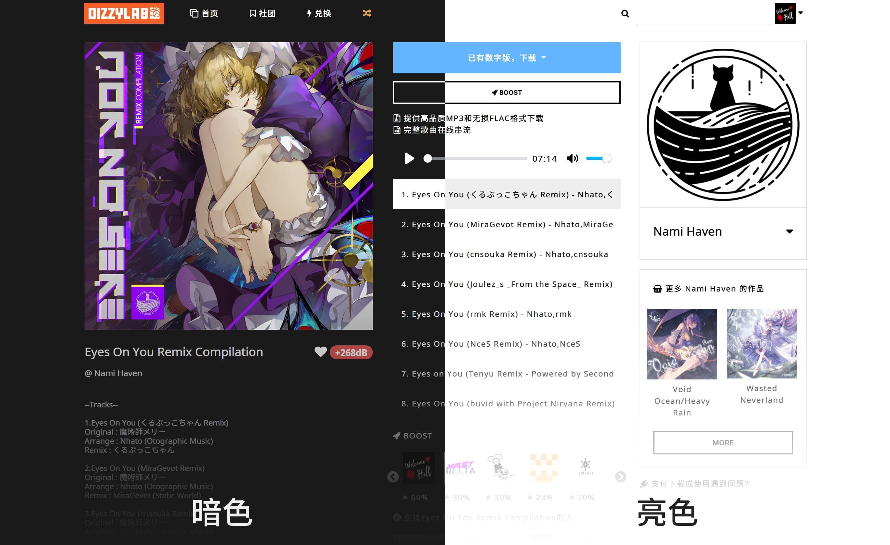

# dizzylab auto theme
[dizzylab](https://www.dizzylab.net/) 自适应主题, 跟随系统亮/暗设定.



## 安装
> 需要浏览器拥有 [Stylus](https://github.com/openstyles/stylus) 或其他同类插件.

[点击此处](https://cdn.jsdelivr.net/gh/the1812/dizzylab-auto-theme@master/dizzylab.user.css)安装.

## 文件说明
- `dizzylab.scss`: 项目的源码文件。这里可以使用变量、嵌套等 SCSS 语法，日常修改应优先改这个文件。
- `dizzylab.user.css`: 最终发布文件。构建脚本会直接从 `dizzylab.scss` 编译出 CSS，并补上 UserStyle 元数据后写入这个文件，浏览器样式插件实际安装的是它。

默认构建链路是：

`dizzylab.scss` -> `dizzylab.user.css`

如果只是调整样式规则，改 `dizzylab.scss` 即可；其余文件由构建流程生成。

## 编译
```powershell
pnpm install
pnpm run build
```

## 监听

```powershell
pnpm run watch
```

`pnpm run watch` 会监听仓库内的 `.scss` 文件和 `package.json` 变化，并自动重新生成 `dizzylab.user.css`。
